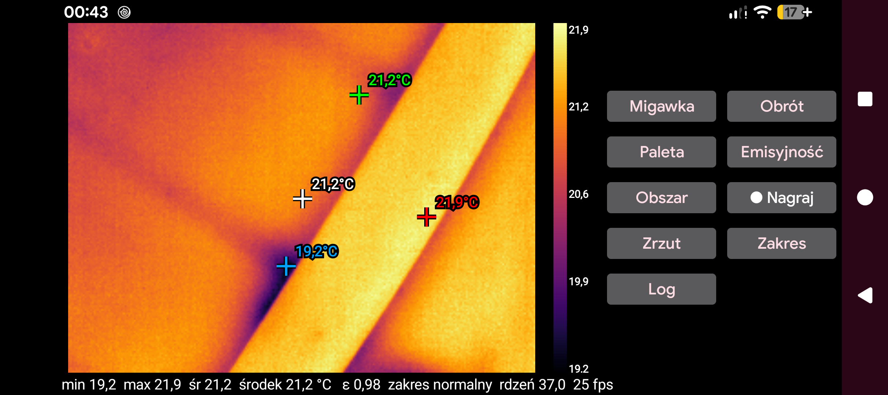
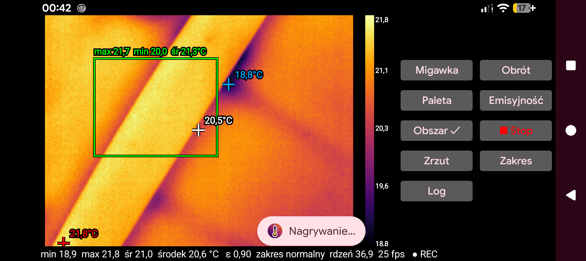

# Termo S0-40

**Nieoficjalna** aplikacja na Androida i skrypty w Pythonie (Windows) do kamery termowizyjnej z modułem
**InfiRay „S0-40”** (USB VID `1514`, PID `0001`), sprzedawanej m.in. jako **QianLi Super Cam X**.

## ⬇️ [Pobierz aplikację (APK) – najnowsza wersja](https://github.com/jkusa87-art/termo-s0-40/releases/latest)

Na stronie wydania przewiń do sekcji **Assets** i kliknij plik **TermoS040-….apk**. Instrukcja instalacji jest [niżej](#instalacja-na-telefonie).
*English: [Download the APK (latest release)](https://github.com/jkusa87-art/termo-s0-40/releases/latest) – file `TermoS040-….apk` under **Assets**.*

## Dlaczego powstała

Nie udało mi się znaleźć aplikacji, która obsłużyłaby tę kamerę na nowym telefonie. Aplikacja producenta
(**QianLi IR**, wersja x64 V1.00.00.26) na **Google Pixel 9a z Androidem 16** nie rozpoznaje modułu S0-40:
pokazuje „UnknowDevice” i „Cannot found current camera config”. Starsza, 32-bitowa wersja aplikacji
(R1.00.00.18) działa na starszych telefonach, ale nie da się jej zainstalować na telefonach obsługujących
już tylko aplikacje 64-bitowe (np. Pixel 9a). Dlatego powstała ta aplikacja – działa bez aplikacji producenta.

> Projekt nie jest związany z QianLi ani InfiRay. Nazwy producentów służą wyłącznie do opisania,
> z jakim sprzętem działa. Bez żadnej gwarancji – używasz na własną odpowiedzialność.

*English summary below.*



## Co potrafi aplikacja (Android)

- obraz na żywo 256×192, 25 kl./s, temperatura min / max / środek / w punkcie dotknięcia,
- **Obszar** – ramka przeciągnięta palcem: max, min i średnia w zaznaczeniu,
- **Obrót** co 90° (np. gdy trzymasz kamerę do góry nogami),
- **Paleta** – INFERNO, JET, TURBO, HOT, BONE,
- **Emisyjność** – wybór materiału (skóra, farba, beton, drewno, metal…),
- **Migawka** (kalibracja), **Zakres** normalny (-20…120 °C) / wysoki (-20…450 °C),
- **Zrzut** – PNG z temperaturami do *Pictures/Termo* (+ surowa klatka do analizy),
- **Nagraj** – film MP4 1280×720 do *Movies/Termo*.



## Instalacja na telefonie

1. Pobierz plik `TermoS040-x.y.apk` z [najnowszego wydania](https://github.com/jkusa87-art/termo-s0-40/releases/latest) (sekcja **Assets**).
2. Otwórz go na telefonie i zezwól na instalację z tego źródła. Android może ostrzec, że aplikacja
   nie pochodzi ze Sklepu Play – to normalne dla aplikacji instalowanych z pliku.
3. Podłącz kamerę do USB-C. Gdy Android zapyta, którą aplikacją ją otworzyć, wybierz **Termo S0-40**
   (najlepiej „zawsze”).
4. Zezwól na dostęp do **aparatu** – Android wymaga tego uprawnienia dla każdej kamery USB (UVC);
   aplikacja nie używa wbudowanych aparatów telefonu.

**Wymagania:** Android 12 lub nowszy, telefon 64-bit (arm64), port USB-C z obsługą OTG.

## Sprawdzone na

| Sprzęt | Wynik |
|---|---|
| Kamera **QianLi Super Cam X** z modułem InfiRay S0-40 (USB 1514:0001, firmware 2.00.210225, 256×192) | działa |
| Telefon **Google Pixel 9a** (Android 16, tylko 64-bit), kamera w porcie USB-C | działa, 25 kl./s, wszystkie funkcje |
| Windows 11 + Python 3.12 + OpenCV 5 | działa |

Pomiary porównano z oficjalną aplikacją QianLi (starsza wersja na innym telefonie) na tej samej dłoni.

Inne telefony i inne kamery InfiRay/Xtherm **nie były testowane**. Zgłoś w *Issues*, czy u Ciebie działa.

## Dokładność

- Przeliczenie temperatur pochodzi z biblioteki [ht301_hacklib](https://github.com/stawel/ht301_hacklib).
- Dłoń: Python 36.3 °C (środek) wobec 35.9 °C w oficjalnej aplikacji QianLi – różnica < 0.5 °C.
- Wersja na Androida daje **identyczne** wyniki jak Python na tej samej surowej klatce
  (`python/porownaj_klatke.py`).
- **Zakres wysoki (do 450 °C) nie był sprawdzony** na gorącym obiekcie – wyniki mogą odbiegać.
- Pomiar zależy od emisyjności: błyszczący metal mierzy się źle w każdej kamerze termowizyjnej.

## Python (Windows)

Wymaga Pythona 3.10+ oraz `pip install opencv-python numpy`.

```
cd python
py -3 termo_live.py            # podgląd na żywo (domyślnie kamera o indeksie 1)
py -3 termo_live.py --index 0  # jeśli kamera ma inny indeks
py -3 termo_test.py 1          # jedna klatka: zapis termo_temperatury.png i termo_log.txt
```

Klawisze podglądu: `q` wyjście, `c` migawka, `p` paleta, `s` zrzut, `r` zakres, mysz – temperatura w punkcie.
Na Windows obraz surowy daje tylko backend **MSMF** (DirectShow zwraca przekonwertowany obraz – nieprzydatny).

## Budowanie aplikacji ze źródeł

Wymaga Android Studio (JDK, SDK 36). NDK nie jest potrzebny osobno – Gradle doinstaluje CMake.

```
cd android
gradlew.bat assembleDebug
```

Wersja do publikacji, podpisana własnym kluczem:

1. `utworz_klucz.bat` – jednorazowo tworzy klucz w folderze domowym (hasło wpisujesz sam),
2. skopiuj `keystore.properties.przyklad` jako `keystore.properties` i wpisz hasło,
3. `zbuduj_apk.bat` – gotowy plik w `android/wydanie/`.

`keystore.properties` i plik klucza są w `.gitignore` – **nigdy ich nie publikuj**.

## Jak to działa (dla programistów)

- Kamera to urządzenie UVC: format YUY2 256×196 @ 25 fps, ale w trybie surowym każdy piksel to
  14-bitowa wartość `uint16` (LE). 192 linie obrazu + 4 linie metadanych (temperatura migawki,
  matrycy, współczynniki kalibracji, emisyjność…).
- Strumień idzie **wyłącznie transferem izochronicznym** (EP 0x81, 524 B), którego nie obsługuje
  Java/Kotlin API Androida. Dlatego jedyny kod natywny to `android/app/src/main/cpp/uvc_iso.c`:
  odbiór izochroniczny przez `ioctl` usbfs na deskryptorze z `UsbDeviceConnection`
  (bez libusb/libuvc, bez roota).
- Negocjacja UVC (probe/commit), wybór alt setting i komendy kamery są w `UvcCamera.kt`.
  Komendy InfiRay wysyła się jako `SET_CUR` kontrolki `CT_ZOOM_ABSOLUTE`:
  `0x8004` tryb surowy 16-bit, `0x8000` migawka, `0x8020/0x8021` zakres,
  emisyjność – 4 bajty floata jako `((16+i) << 8) | bajt`.
- Przeliczenie na °C: `ThermalMath.kt` (port `info()` + `get_temp_table()` z ht301_hacklib).
- `narzedzia/usb_deskryptory.py` – odczyt deskryptorów USB na Windows (formaty, typ transferu).

## Licencja i podziękowania

GPL-3.0 – zobacz [LICENSE](LICENSE).

Wzory przeliczenia temperatur i protokół komend pochodzą z projektu
[stawel/ht301_hacklib](https://github.com/stawel/ht301_hacklib) (GPL-3.0) i jego współtwórców.
Kopia biblioteki jest w `python/ht301_hacklib-master` z oryginalną licencją.

---

## English summary

Unofficial Android app and Windows Python scripts for thermal cameras using the **InfiRay "S0-40"**
module (USB `1514:0001`), sold e.g. as **QianLi Super Cam X**. I could not find any app that supports
this camera on a new phone: the manufacturer's app (QianLi IR x64 V1.00.00.26) does not recognise the module
on a **Google Pixel 9a with Android 16** ("UnknowDevice"), and the older 32-bit version cannot be installed on
64-bit-only phones – so this app was written. Not affiliated with QianLi or InfiRay. No warranty.

- **Tested on:** QianLi Super Cam X (InfiRay S0-40, firmware 2.00.210225) + Google Pixel 9a (Android 16), 25 fps.

- **Install:** download the APK from *Releases*, allow installing from unknown sources, plug in the
  camera, pick *Termo S0-40*, grant the camera permission (Android requires it for any UVC device).
  Android 12+, arm64 only.
- **Features:** live 25 fps image, min/max/centre/touch temperature, area measurement, 90° rotation,
  palettes, emissivity presets, shutter, normal/high range, PNG snapshots, MP4 recording.
- **Accuracy:** hand measurement within 0.5 °C of the official app;
  Android and Python give identical results on the same raw frame. The high range (up to 450 °C) is untested.
- **How:** the camera streams only via isochronous USB transfers, so a small C file reads them through
  usbfs ioctls (no libusb/libuvc, no root); everything else is Kotlin. Temperature formula ported from
  [stawel/ht301_hacklib](https://github.com/stawel/ht301_hacklib).
- **License:** GPL-3.0.
